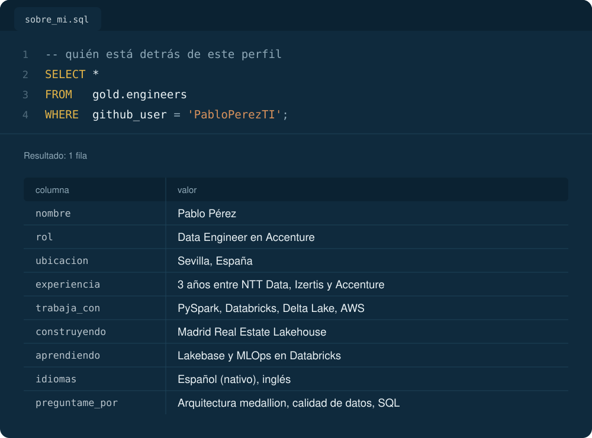
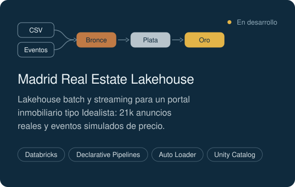
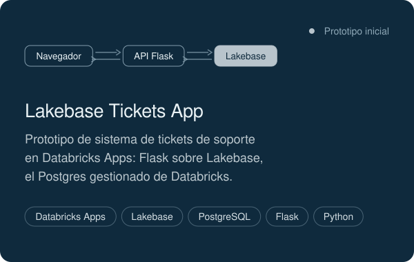
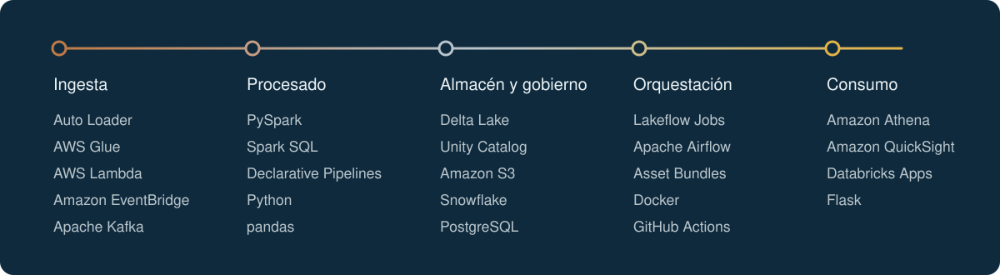

[English](README.md) | **Español**

Soy data engineer con tres años en consultoría, construyendo pipelines de PySpark para clientes de banca y seguros. Ahora casi todo mi trabajo pasa por el lakehouse de Databricks: declarative pipelines, Unity Catalog, Delta Lake y Auto Loader sobre AWS.

Me gusta la parte poco vistosa que hace que los datos sean fiables: reglas de identidad para fuentes que no tienen clave, controles de calidad que ponen en cuarentena las filas malas en lugar de descartarlas sin avisar, y un linaje que se pueda seguir de verdad.

## Proyectos destacados

  
  

**[Madrid Real Estate Lakehouse](https://github.com/PabloPerezTI/real-estate-lakehouse)** es donde practico el trabajo de plataforma de principio a fin. Modela unos 21.000 anuncios reales de Madrid y un simulador de eventos con estado que deja los cambios de precio en S3. Las capas bronce y plata corren sobre Lakeflow Spark Declarative Pipelines y se gobiernan en Unity Catalog; la siguiente es un modelo en estrella en oro. Las notas de diseño explican cada decisión de modelado, incluida la clave de propiedad derivada por hash para una fuente que no tiene clave natural.

**[Lakebase Tickets App](https://github.com/PabloPerezTI/databricks-lakebase-tickets-app)** es un prototipo inicial de sistema de tickets de soporte preparado para correr como Databricks App. La capa de datos ya está: un servicio en Flask se conecta a Lakebase (Postgres gestionado) a través de un secret scope y toma la identidad del usuario de las cabeceras que reenvía la app. Lo siguiente son los endpoints de tickets.

## Stack

## Certificaciones

## Contribuciones

<picture>
  <source media="(prefers-color-scheme: dark)" srcset="https://raw.githubusercontent.com/PabloPerezTI/PabloPerezTI/output/snake-dark.svg">
  <source media="(prefers-color-scheme: light)" srcset="https://raw.githubusercontent.com/PabloPerezTI/PabloPerezTI/output/snake-light.svg">
  
</picture>

## Contacto

Encantado de hablar de diseño de lakehouses, Databricks o cualquier cosa de data engineering. Escríbeme a [pabloperezorti@gmail.com](mailto:pabloperezorti@gmail.com).

Fuera del trabajo cofundé [Meritia](https://meritia.es), un pequeño negocio de soportes NFC para reseñas, que es donde aprendí a sacar cosas adelante de principio a fin.
