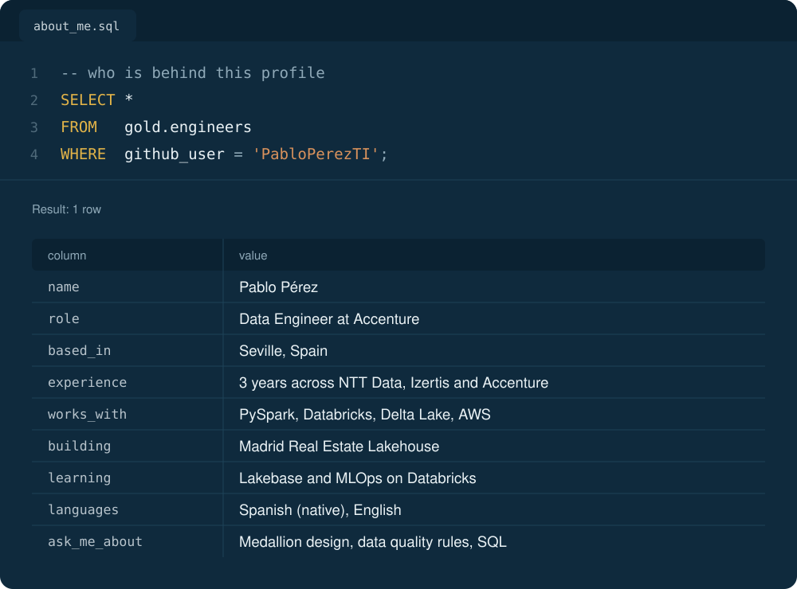
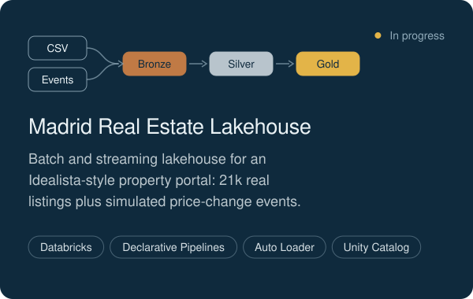
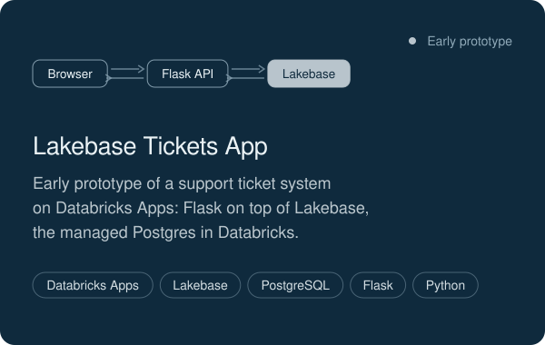
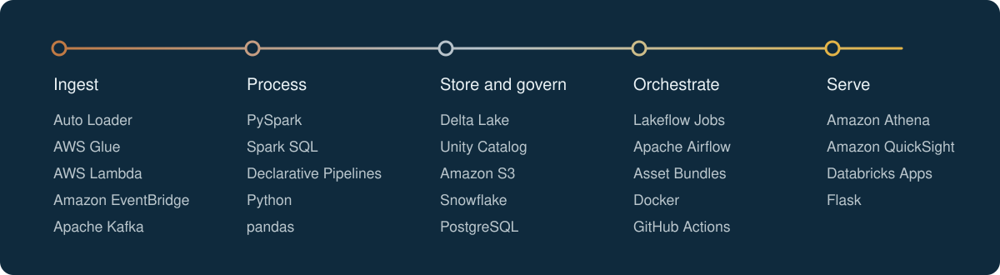

**English** | [Español](README.es.md)

I'm a data engineer with three years in consulting, building PySpark pipelines for banking and insurance clients. Most of my work now happens on the Databricks lakehouse, with declarative pipelines, Unity Catalog, Delta Lake and Auto Loader running on AWS.

I enjoy the unglamorous parts that make data trustworthy: identity rules for sources that don't have keys, data quality checks that quarantine bad rows instead of silently dropping them, and lineage you can actually follow.

## Featured work

  
  

**[Madrid Real Estate Lakehouse](https://github.com/PabloPerezTI/real-estate-lakehouse)** is where I practise end-to-end platform work. It models about 21,000 real Madrid listings plus a stateful event simulator that lands price changes in S3. Bronze and silver run on Lakeflow Spark Declarative Pipelines and are governed in Unity Catalog, with a gold star schema coming next. The design notes explain each modelling decision, including the hash-derived property key for a source that has no natural one.

**[Lakebase Tickets App](https://github.com/PabloPerezTI/databricks-lakebase-tickets-app)** is an early prototype of a support ticket system built to run as a Databricks App. The data layer is in place: a Flask service connects to Lakebase (managed Postgres) through a secret scope and picks up user identity from the app's forwarded headers. The ticket endpoints are next.

## Stack

## Certifications

## Contributions

<picture>
  <source media="(prefers-color-scheme: dark)" srcset="https://raw.githubusercontent.com/PabloPerezTI/PabloPerezTI/output/snake-dark.svg">
  <source media="(prefers-color-scheme: light)" srcset="https://raw.githubusercontent.com/PabloPerezTI/PabloPerezTI/output/snake-light.svg">
  
</picture>

## Get in touch

Happy to talk about lakehouse design, Databricks or anything data engineering. Email me at [pabloperezorti@gmail.com](mailto:pabloperezorti@gmail.com).

Outside the day job I co-founded [Meritia](https://meritia.es), a small business that sells NFC review stands, which is where I learned to ship things end to end.
